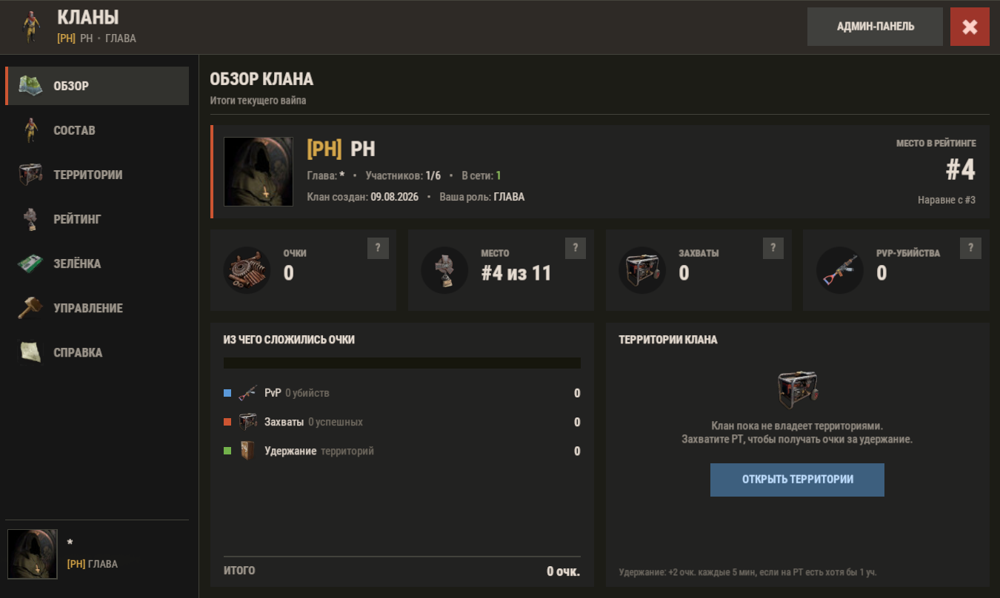

# RockRustClans

Полноценная клановая система для Rust: интерфейс, роли, рейтинг за вайп, привязка к игровой команде и захват территорий у монументов.



**Платформа:** Oxide/uMod · Carbon  **Язык:** C#  **Версия:** 3.0.1  **Автор:** Avgust

## Возможности

- **Кланы с GUI**: создание, приглашения, роли (глава, заместитель, свои роли), передача лидерства, исключение, смена названия и тега. Всё делается через интерфейс, команды не обязательны
- **Привязка к команде Rust**: клан связан с игровой (зелёной) командой, при выходе или исключении игрок убирается и из неё
- **Захват территорий у монументов**:
  - у точки ставится генератор, клан заправляет его ТНК и удерживает зону
  - прогресс идёт, только пока в зоне достаточно участников и есть топливо; без защитников прогресс падает
  - если в зону заходит враг, точка становится «оспариваемой»; можно перехватить захват, если генератор пустой
  - перезарядка точки после захвата и после сорванного захвата, защита от повторного перехвата
  - вокруг точки строится площадка с ограждением
- **Рейтинг кланов**: очки за убийства игроков других кланов (с защитой от фарма одного игрока), за захват и удержание территорий; автосброс при вайпе
- **HUD захвата** на экране: статус, прогресс, топливо
- **Клановый чат** `/c`, тег клана в общем чате (совместимо с BetterChat)
- **Админ-панель**: кланы, статистика с графиками, журнал, настройка территорий прямо в игре, ручная корректировка очков
- **Скрытый режим**: систему можно сначала протестировать администраторами, а потом открыть для всех

## Зависимости

- BetterChat — необязательно. Если он стоит, тег клана добавляется в его формат сообщения.

## Установка

1. Скопируй `RockRustClans.cs` в `oxide/plugins` (или `carbon/plugins`).
2. Конфиг: `oxide/config/RockRustClans.json`, данные: `oxide/data/RockRustClans.json`.
3. По умолчанию система доступна только администраторам. Чтобы открыть её игрокам, включи «Включить систему для обычных игроков» в конфиге и перезагрузи плагин.

## Команды

| Команда | Кто | Что делает |
|---|---|---|
| `/clan` | все | Открыть меню клана |
| `/clan create <TAG>` | все | Создать клан |
| `/clan invite`, `accept`, `decline`, `leave`, `kick` | все | Управление составом |
| `/clan transfer`, `deputy`, `rename`, `retag`, `disband` | глава | Управление кланом |
| `/clan capture` / `cancelcapture` / `takeover` | участники | Захват территории |
| `/clan top` | все | Рейтинг кланов |
| `/c <текст>` | участники | Клановый чат |
| `/clanadmin` | админ | Админ-панель |

## Права

| Право | Что даёт |
|---|---|
| `rockrustclans.admin` | Админ-панель, настройка территорий, корректировка очков |

## API

```csharp
string tag   = RockRustClans?.Call<string>("API_GetClanTag", playerId);
bool  mates  = RockRustClans?.Call<bool>("API_AreClanMates", id1, id2) ?? false;
int   score  = RockRustClans?.Call<int>("API_GetClanScore", tag) ?? 0;
```

## Как устроено

- **Тик захвата.** Таймер раз в N секунд обходит территории: считает своих и чужих в зоне, списывает ТНК из генератора, двигает или откатывает прогресс и меняет статус (`capturing`, `contested`, `no_defenders`, `waiting_fuel`, `takeover_ready`).
- **Генератор захвата.** Работает через штатные хуки Oxide (`OnSwitchToggle`, `OnItemAddedToContainer`) и трогает только генераторы, созданные плагином. Обычные генераторы на сервере не затрагиваются.
- **Отложенное сохранение.** Изменения помечают данные «грязными», а запись на диск идёт не чаще раза в 10 секунд и обязательно при сохранении сервера и выгрузке плагина.
- **Индекс игрок → клан** в памяти для быстрых проверок в частых хуках (урон, смерть, чат).
- **Ремонт старых данных.** Конфиги, раздутые прошлыми версиями, чистятся при загрузке, калибровка точек сохраняется.
- **Оптимизация UI.** Открытая вкладка перерисовывается только при реальных изменениях, пустые команды HUD не отправляются.

---
Автор: **Avgust** · Заказать плагин: @Avg4st1n
